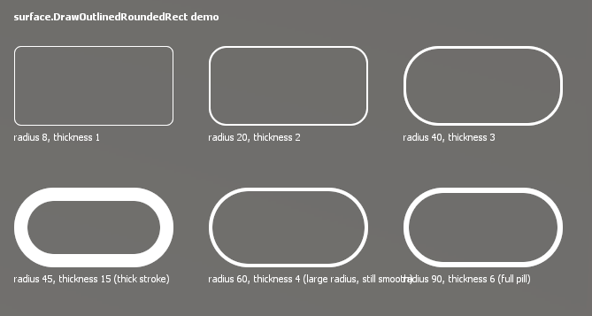

# Rounded Rect Outline for Garry's Mod

`surface.DrawOutlinedRoundedRect` draws rounded rectangle outlines in HUD and VGUI paint hooks. Both the outside and inside edges use a soft alpha transition, including the inner edge around the hollow center.

The library is client-side, uses Garry's Mod's built-in Lua APIs, and has no external dependencies.

## Demo

The optional demo shows several corner-radius and stroke-width combinations.

<!-- Replace the placeholder image with a screenshot captured from the demo and commit it as DEMO.png in the repository root. -->


To capture the screenshot, install both files, run `danlib_rounded_rect_demo` in the client console, and capture the showcase panel.

## Installation

Copy the library to your addon's client autorun folder:

```text
your_addon/
└── lua/
    └── autorun/
        └── client/
            └── cl_rounded_rect.lua
```

The library's full addon path is `lua/autorun/client/cl_rounded_rect.lua`.

The visual demo is optional. Copy `cl_rounded_rect_demo.lua` into the same folder, after `cl_rounded_rect.lua`, and ensure the library loads first:

```text
your_addon/
└── lua/
    └── autorun/
        └── client/
            ├── cl_rounded_rect.lua
            └── cl_rounded_rect_demo.lua
```

Restart or reload the addon on the client. The drawing function is added to the global `surface` table when the library file loads.

## Quick start

Call the function from a paint hook:

```lua
hook.Add('HUDPaint', 'MyRoundedOutline', function()
    surface.DrawOutlinedRoundedRect(
        100, 100,      -- x, y
        240, 100,      -- width, height
        24,            -- corner radius
        3,             -- stroke thickness
        color_white
    )
end)
```

`surface.DrawOutlinedRoundedRect` uses screen/UI pixel coordinates. Call it only while drawing, such as inside `HUDPaint`, `PostDrawHUD`, or a VGUI panel's `Paint` method.

## API

```lua
surface.DrawOutlinedRoundedRect(x, y, w, h, radius, thickness, color)
```

| Parameter | Type | Default | Description |
|---|---|---|---|
| `x`, `y` | number | — | Top-left position |
| `w`, `h` | number | — | Rectangle width and height |
| `radius` | number | `0` | Corner radius, limited by half the shorter side |
| `thickness` | number | `1` | Stroke width in pixels |
| `color` | Color | `color_white` | Stroke color; the color's alpha is preserved |

### Parameter rules

- Coordinates, width, height, radius, and thickness are rounded to whole pixels.
- Negative width or height is treated as zero. A zero-sized rectangle draws nothing.
- Radius is clamped to `0..min(floor(w / 2), floor(h / 2))`.
- With a positive radius, thickness is clamped to `0..radius`.
- With radius `0`, the function draws a square-cornered rectangle and clamps thickness to half the shorter side.
- A zero or negative thickness draws nothing.
- The function does not return a value.

The outline's antialiasing fringe can extend up to `0.5` pixels outside the supplied rectangle. Allow for this when drawing close to clipping boundaries.

## Examples

### HUD outline

```lua
hook.Add('HUDPaint', 'StatusCardOutline', function()
    local x, y = 80, 100
    local width, height = 260, 96
    surface.DrawOutlinedRoundedRect(x, y, width, height, 18, 2, Color(125, 138, 205))
end)
```

### Pill-shaped outline

Use half the height as the radius to make a pill:

```lua
hook.Add('HUDPaint', 'PillOutline', function()
    local x, y = 80, 220
    local width, height = 280, 56
    surface.DrawOutlinedRoundedRect(x, y, width, height, height / 2, 3, Color(116, 192, 160))
end)
```

### Outline over a filled panel

Draw the fill first, then draw the outline over it:

```lua
hook.Add('HUDPaint', 'FilledCard', function()
    local x, y = 80, 310
    local width, height = 260, 88
    local radius = 16
    draw.RoundedBox(radius, x, y, width, height, Color(28, 34, 46))
    surface.DrawOutlinedRoundedRect(x, y, width, height, radius, 2, Color(90, 180, 255))
end)
```

### Draw from a VGUI panel

Coordinates passed from `Paint(self, width, height)` are local to the panel:

```lua
local panel = vgui.Create('DPanel')
panel:SetSize(280, 84)
panel:SetPaintBackground(false)
panel.Paint = function(self, width, height)
    surface.DrawOutlinedRoundedRect(0, 0, width, height, 18, 2, Color(120, 190, 255))
end
```

### Compare radius and thickness settings

```lua
local examples = {
    { radius = 8,  thickness = 1, color = Color(125, 138, 205) },
    { radius = 20, thickness = 2, color = Color(116, 192, 160) },
    { radius = 40, thickness = 4, color = Color(240, 180, 90) },
    { radius = 40, thickness = 15, color = Color(235, 110, 130) }
}

hook.Add('HUDPaint', 'OutlineComparison', function()
    for i = 1, #examples do
        local example = examples[i]
        local x = 80 + (i - 1) * 220
        surface.DrawOutlinedRoundedRect(x, 420, 190, 92, example.radius, example.thickness, example.color)
    end
end)
```

The radius is automatically reduced if the rectangle is too small to fit it.

### Translucent outline

The alpha component of the color is combined with the edge fade:

```lua
hook.Add('HUDPaint', 'TranslucentOutline', function()
    surface.DrawOutlinedRoundedRect(380, 100, 240, 80, 18, 3, Color(90, 180, 255, 150))
end)
```

## How it works

Rounded outlines are built as a triangle mesh. Each corner has three radial bands: an outer fade, a solid stroke, and an inner fade. Matching horizontal and vertical bands form the straight sections. Vertex alpha is interpolated across the triangles to soften both edges.

The library creates its material once when the file loads. It does not create render targets or read/write the stencil buffer. Unit points for quarter-circle arcs are cached by segment count and reused across draw calls. Corner detail is selected from 32 to 96 segments based on the radius.

The radius controls the corner geometry; it does not change the requested rectangle's width or height. The edge fringe is intentionally soft and may reach half a pixel outside the given bounds.

## Demo command

With `cl_rounded_rect_demo.lua` installed, run this client console command to show or hide the demo:

```text
danlib_rounded_rect_demo
```

The demo hook is removed when the command is run a second time. The demo file can also be omitted entirely from an addon that does not need the showcase.

## Performance and troubleshooting

- Each rounded outline call generates one mesh. Avoid drawing outlines that are off-screen or hidden behind another panel.
- The material and unit arc coordinates are cached; the mesh itself is generated for each call.
- If nothing appears, confirm the library is installed in `lua/autorun/client`, the client has loaded it, and the call runs inside a paint hook.
- If the edge is clipped, inset the rectangle slightly to leave room for the half-pixel antialiasing fringe.
- If an outline is unexpectedly rectangular, check that its radius is greater than zero and that its dimensions are large enough for the requested radius.
- If there is no visible outline, check that thickness is greater than zero and that the color alpha is not zero.

For a screen with many frequently redrawn outlines, profile it in-game and reduce unnecessary draw calls.

## License

MIT License.
